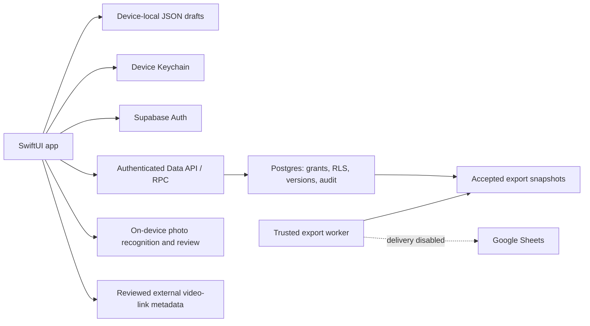

# TeamStats architecture

Documentation snapshot: 2026-10-12, source reviewed at `737ca4a`.
This describes implementation and boundaries, not release acceptance.

## Reading order and source map

[PRD.md](PRD.md) owns requirements; [AGENTS.md](AGENTS.md) owns working rules;
[GLOSSARY.md](GLOSSARY.md) owns terminology. Adopted [ADRs](docs/adr/) explain
decisions. Source/migrations establish implementation; recorded checks establish
verification only in their tested environment. Report contradictions rather than
silently treating the newest prose as authority. Private setup/tickets stay private.

| Document section | Implementation source | Contract / verification entry point |
|---|---|---|
| Architecture: navigation and local storage | [ContentView.swift](TeamStats/TeamStats/ContentView.swift), [BoxScore.swift](TeamStats/TeamStats/BoxScore.swift), [Possession.swift](TeamStats/TeamStats/Possession.swift), [PlayerPaintTouches.swift](TeamStats/TeamStats/PlayerPaintTouches.swift) | PRD; [LocalDraftTests](TeamStats/TeamStatsTests/LocalDraftTests.swift); WORKFLOW |
| Architecture/security: account and sessions | [BackendAccount.swift](TeamStats/TeamStats/BackendAccount.swift), [SecureSessionStorage.swift](TeamStats/TeamStats/SecureSessionStorage.swift) | [AccountTests](TeamStats/TeamStatsTests/AccountTests.swift); [backend README](supabase/README.md) |
| Architecture/security: administration | [TeamAdministration.swift](TeamStats/TeamStats/TeamAdministration.swift), [migration 001](supabase/migrations/202610110001_team_access.sql) | [ADR 0001](docs/adr/0001-reviewed-dataset-versions-and-bounded-grants.md); [team access tests](supabase/tests/team_access.sql) |
| Architecture/security: statistics lifecycle | [ConnectedStatistics.swift](TeamStats/TeamStats/ConnectedStatistics.swift), migrations [002](supabase/migrations/202610110002_stat_versions.sql)/[009](supabase/migrations/202610110009_stat_draft_recovery.sql) | [statistics contract](supabase/statistics.md); [version tests](supabase/tests/stat_versions.sql)/[recovery tests](supabase/tests/stat_draft_recovery.sql) |
| Architecture: accepted calculations | [GameStatistics.swift](TeamStats/TeamStats/GameStatistics.swift), [PublishedStatisticsView.swift](TeamStats/TeamStats/PublishedStatisticsView.swift) | [GameStatisticsTests](TeamStats/TeamStatsTests/GameStatisticsTests.swift) |
| Architecture/security: Sheets boundary | [migration 003](supabase/migrations/202610110003_stat_exports.sql), [worker](supabase/sheets_export.py) | [export contract](supabase/exports.md); [worker tests](supabase/tests/test_sheets_export.py) |
| Architecture/security: plays and media | [Playbook.swift](TeamStats/TeamStats/Playbook.swift), [MediaResources.swift](TeamStats/TeamStats/MediaResources.swift), migrations 004–008 | [plays](supabase/plays.md), [media](supabase/media_resources.md), [ADR 0002](docs/adr/0002-reviewed-plays-ocr-and-budgeted-media.md) |
| Architecture/security: photo input | [PhotoDraftImport.swift](TeamStats/TeamStats/PhotoDraftImport.swift) | ADR 0002; [photo tests](TeamStats/TeamStatsTests/PhotoDraftImportTests.swift) |
| Testing: native and actual local integration | [native tests](TeamStats/TeamStatsTests/), [gateway harness](supabase/tests/team_access_gateway.py), [SQL tests](supabase/tests/) | [TESTING.md](TESTING.md); subsystem evidence and WORKFLOW |
| README: observable app flows | [AccountView](TeamStats/TeamStats/AccountView.swift), [administration view](TeamStats/TeamStats/TeamAdministrationView.swift), [shared games](TeamStats/TeamStats/ConnectedGamesView.swift), [entry](TeamStats/TeamStats/ConnectedStatEntry.swift) | PRD; manual acceptance remains distinct from source wiring |

## System boundaries

SwiftUI views delegate shared operations to account/administration/statistics/play
and media models using the pinned Supabase Swift SDK. SQL commands own authority,
transactions and version checks. UI restrictions alone do not secure records.

## Local drafts versus official shared data

Games/Players tabs use provisional identities and four separate atomic JSON
stores: games, box scores, possessions and player paint-touch totals. Local
summaries are incomplete/unreviewed; blank differs from zero. Signing in does
not upload those records or turn temporary players into actual roster entries.

Account → Team administration opens shared workflows. Shared roster entries have
stable real identities and retained revisions; archiving preserves history.
Shared statistics use four independent dataset types: box scores, our possessions,
opponent possessions and player paint-touch totals. Saved is not completed;
completed is not submitted; submitted is not accepted/published.

Completion requires the server's current version and relevant confirmations.
Possession numeric blanks become zero only through successful confirmed completion;
box-score/player-total optional measurements remain missing. Accepted versions
are immutable. Approved edit requests produce new drafts while accepted content
remains available. Superseded proposals are retained read-only; recovery requires
authorized reload, explicit attachment and a separate Save.

## Identity, authority and calculations

Supabase verifies accounts; Keychain stores device configuration, PKCE challenge
and sessions. Verified account identity does not itself confer team membership.
Trusted administration bootstraps ownership; clients cannot nominate themselves.
Membership, operational capabilities and bounded delegation are separate contracts.
See [SECURITY.md](SECURITY.md) for trust and revocation limits.

Accepted summaries use completion state supplied by the shared lifecycle, not
numeric coverage alone. Calculations preserve missing/invalid/overflow/zero-attempt
states. Real Possessions is each team's possession count minus turnovers plus
offensive rebounds. Reconciliation compares supported player/team scoring and
shot categories without inventing player attribution to possessions.

## External features and present limits

- Export snapshots/outbox and a trusted worker are implemented; Google delivery
  is disabled and actual delivery remains unverified. Sheets is an output, not
  the official source. Export status is separate from statistical acceptance.
- Plays use editable court markers/movement steps and immutable accepted revisions.
  Photo recognition runs on device; reviewed mappings change only existing unsaved
  input. Representative filled-form accuracy remains pending.
- Practice/game-film link metadata and review are implemented. File upload,
  transfer-budget enforcement, provider rights and private playback are unfinished.
- Upcoming-opponent scouting reports are planned; format/access/linkage decisions
  and implementation remain outstanding.
- Full offline synchronization and persistent connected-data caching are deferred.
  Recovery buffers do not constitute an offline queue or durable server replica.

## Maintenance

Update this overview when storage boundaries, source modules, version lifecycle
or external integrations change. Keep detailed RPC contracts in `supabase/` and
material decisions in ADRs. Put dated acceptance evidence in existing records,
with public-safe status in [TESTING.md](TESTING.md). No provider identifiers,
tokens, real roster examples or private setup paths belong here.
