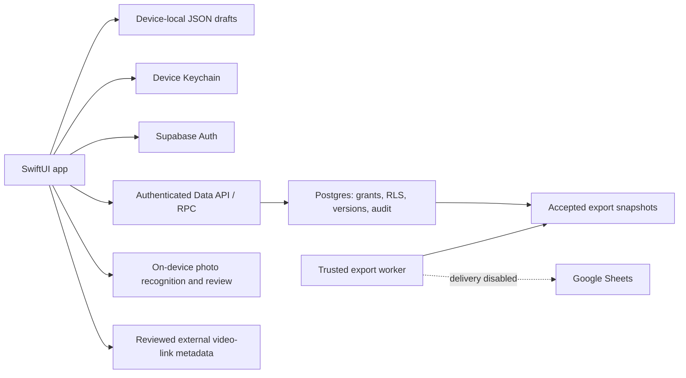

# TeamStats architecture

Documentation snapshot: 2026-10-12, integration through `e7b119e` plus reviewed native file UI.
This describes implementation and boundaries, not release acceptance.

## Reading order and source map

[PRD.md](PRD.md) owns requirements; [AGENTS.md](AGENTS.md) owns working rules;
[GLOSSARY.md](GLOSSARY.md) owns terminology. Adopted [ADRs](docs/adr/) explain
decisions. Source/migrations establish implementation; recorded checks establish
verification only in their tested environment. Report contradictions rather than
silently treating the newest prose as authority. Private setup/tickets stay private.

| Document section | Implementation source | Contract / verification entry point |
|---|---|---|
| Architecture: navigation and local storage | [ContentView.swift](TeamStats/TeamStats/ContentView.swift), [BoxScore.swift](TeamStats/TeamStats/BoxScore.swift), [Possession.swift](TeamStats/TeamStats/Possession.swift), [PlayerPaintTouches.swift](TeamStats/TeamStats/PlayerPaintTouches.swift) | PRD; [LocalDraftTests](TeamStats/TeamStatsTests/LocalDraftTests.swift); WORKFLOW |
| Architecture/security: account and sessions | [BackendAccount.swift](TeamStats/TeamStats/BackendAccount.swift), [SecureSessionStorage.swift](TeamStats/TeamStats/SecureSessionStorage.swift) | [AccountTests](TeamStats/TeamStatsTests/AccountTests.swift); [backend README](supabase/README.md) |
| Architecture/security: administration | [TeamAdministration.swift](TeamStats/TeamStats/TeamAdministration.swift), [migration 001](supabase/migrations/202610110001_team_access.sql) | [ADR 0001](docs/adr/0001-reviewed-dataset-versions-and-bounded-grants.md); [team access tests](supabase/tests/team_access.sql) |
| Architecture/security: statistics lifecycle | [ConnectedStatistics.swift](TeamStats/TeamStats/ConnectedStatistics.swift), migrations [002](supabase/migrations/202610110002_stat_versions.sql)/[009](supabase/migrations/202610110009_stat_draft_recovery.sql) | [statistics contract](supabase/statistics.md); [version tests](supabase/tests/stat_versions.sql)/[recovery tests](supabase/tests/stat_draft_recovery.sql) |
| Architecture: accepted calculations | [GameStatistics.swift](TeamStats/TeamStats/GameStatistics.swift), [PublishedStatisticsView.swift](TeamStats/TeamStats/PublishedStatisticsView.swift) | [GameStatisticsTests](TeamStats/TeamStatsTests/GameStatisticsTests.swift) |
| Architecture/security: Sheets boundary | [migration 003](supabase/migrations/202610110003_stat_exports.sql), [worker](supabase/sheets_export.py) | [export contract](supabase/exports.md); [worker tests](supabase/tests/test_sheets_export.py) |
| Architecture/security: plays and media | [Playbook.swift](TeamStats/TeamStats/Playbook.swift), [MediaResources.swift](TeamStats/TeamStats/MediaResources.swift), migrations 004–008 | [plays](supabase/plays.md), [media](supabase/media_resources.md), [ADR 0002](docs/adr/0002-reviewed-plays-ocr-and-budgeted-media.md) |
| Architecture/security: photo input | [PhotoDraftImport.swift](TeamStats/TeamStats/PhotoDraftImport.swift) | ADR 0002; [photo tests](TeamStats/TeamStatsTests/PhotoDraftImportTests.swift) |
| Testing: native and actual local integration | [native tests](TeamStats/TeamStatsTests/), [gateway harness](supabase/tests/team_access_gateway.py), [SQL tests](supabase/tests/) | [TESTING.md](TESTING.md); subsystem evidence and WORKFLOW |
| README: observable app flows | [AccountView](TeamStats/TeamStats/AccountView.swift), [administration view](TeamStats/TeamStats/TeamAdministrationView.swift), [shared games](TeamStats/TeamStats/ConnectedGamesView.swift), [entry](TeamStats/TeamStats/ConnectedStatEntry.swift) | PRD; manual acceptance remains distinct from source wiring |

## System boundaries

SwiftUI views delegate shared operations to account/administration/statistics/play
and media models using the pinned Supabase Swift SDK. SQL commands own authority,
transactions and version checks. UI restrictions alone do not secure records.

## Local drafts versus official shared data

Local drafts/Players tabs use provisional identities and four separate atomic JSON
stores: games, box scores, possessions and player paint-touch totals. Local
summaries are incomplete/unreviewed; blank differs from zero. Signing in does
not upload those records or turn temporary players into actual roster entries.

Team opens shared workflows; Manage team protects administrative destinations. Shared roster entries have
stable real identities and retained revisions; archiving preserves history.
Shared statistics use four independent dataset types: box scores, our possessions,
opponent possessions and player paint-touch totals. Saved is not completed;
completed is not submitted; submitted is not accepted/published.

Completion requires the server's current version and relevant confirmations.
Possession numeric blanks become zero only through successful confirmed completion;
box-score/player-total optional measurements remain missing. Accepted versions
are immutable. Approved edit requests produce new drafts while accepted content
remains available. Superseded proposals are retained read-only; recovery requires
authorized reload, explicit attachment and a separate Save.

## Identity, authority and calculations

Supabase verifies accounts; Keychain stores device configuration, PKCE challenge
and sessions. Verified account identity does not itself confer team membership.
Trusted administration bootstraps ownership; clients cannot nominate themselves.
Membership, operational capabilities and bounded delegation are separate contracts.
See [SECURITY.md](SECURITY.md) for trust and revocation limits.

Accepted summaries use completion state supplied by the shared lifecycle, not
numeric coverage alone. Calculations preserve missing/invalid/overflow/zero-attempt
states. Real Possessions is each team's possession count minus turnovers plus
offensive rebounds. Reconciliation compares supported player/team scoring and
shot categories without inventing player attribution to possessions.

## External features and present limits

- Export snapshots/outbox and a trusted worker are implemented; Google delivery
  is disabled and actual delivery remains unverified. Sheets is an output, not
  the official source. Export status is separate from statistical acceptance.
- Plays use editable court markers/movement steps and immutable accepted revisions.
  Photo recognition runs on device; reviewed mappings change only existing unsaved
  input. Representative filled-form accuracy remains pending.
- Full-game film stays on Hudl; reviewed HTTPS shortcuts open provider destinations.
- PrivateFiles/PrivateFilesView handle immutable play-linked clips and game-linked
  scouting PDFs. Authenticated SQL owns reservations/revisions/review/current access;
  a bounded trusted worker validates actual bytes before private Storage publication.
  Native AVPlayer/PDFKit consume complete hash-verified local files. The local Functions
  relay has actual signed checks; hosted deployment is not enabled.
- ClipRetention stores explicit optional copies by project/verified actor/team/version.
  Online opening rechecks current published access; known denial locks retained copies.
  Unknown offline rights are disclosed. Previously delivered bytes cannot reliably be
  recalled. Offline clip retention is not full shared-data synchronization.
- Four local draft stores remain unchanged and are never automatically uploaded.

## Shot capture boundary

ADR0007/0008 now have implemented source and isolated local evidence: an iPad-first
recorder for both teams, durable account/team/game-scoped journal and controlled
deferred submission into a separate reviewed dataset. Official after-game records
are comparison sources, never overwritten or added to captured totals. Free throws
retain per-attempt outcomes without court coordinates. Score reconciliation and
coverage claims remain separate. New migrations18/19 are tested only in isolated
synthetic databases; existing/hosted activation and acceptance remain open.

## Backup and recovery boundary

Application recovery handles retained drafts, stale versions and uncertain replies.
It is not disaster recovery after device loss, app removal or database loss.
Local JSON is not a hosted backup; Keychain's device-only items are not a portable
account/session backup. Published revision history is not an independent database
backup either. `LocalDraftBackup` prepares a read-only, versioned JSON snapshot of
the four validated saved local stores; `TeamStatsGuide` offers explicit export to a
user-selected private destination. Preparation preserves missing values/identities
and fails on corrupt data, with isolated synthetic tests. It excludes unsaved edits,
credentials, shared records and media. There is no in-app importer. Offline
Foundation recovery tooling now validates version/relationships and restores only
to a new directory, reopening all four real stores in synthetic tests. Separate
PostgreSQL17 backup/restore and object-byte drills, CI boundaries and the release
recovery procedure are documented in [RECOVERY.md](RECOVERY.md). They do not prove
hosted disaster recovery, real Auth recovery or an operational backup policy.
New saves request complete file protection without rewriting legacy bytes; physical
protection and backup behavior remain unverified. Provider backup availability/retention and any
restore mechanism must be verified under the $0 budget before promising recovery.

The app owner coordinates incident/data-recovery decisions and authorizes trusted
administrative work; delegates' normal app capabilities confer no database-restore
authority. Operators preserve available state, identify the affected environment
and seek approval before destructive restoration. Recovery objectives, retention,
backup location and restore-test evidence remain `TODO_BACKUP_RECOVERY_POLICY`.
Use synthetic data to verify restoration without overwriting existing records.

## Maintenance

Update this overview when storage boundaries, source modules, version lifecycle
or external integrations change. Keep detailed RPC contracts in `supabase/` and
material decisions in ADRs. Put dated acceptance evidence in existing records,
with public-safe status in [TESTING.md](TESTING.md). No provider identifiers,
tokens, real roster examples or private setup paths belong here.

## Network/session preparation —2026-10-16

[NETWORK.md](NETWORK.md) inventories request bounds/retry/cancellation and uncertain
write recovery. One official Auth coordinator supplies current tokens; its bounded
fetch prevents SDK Auth POST replay. Database operations explicitly disable retries.
Private file admission is a separate durable actor-derived SQL command, not ingress
protection or capacity assurance. Migration14 is tested only in new synthetic
databases; existing/hosted schemas and disabled delivery remain untouched.

## Measured local performance boundary —2026-10-16

[PERFORMANCE.md](PERFORMANCE.md) separates synthetic native load/save/media timings
from actual isolated SQL/Data API plans. Game corrections now filter through the
source version's game under existing RLS, rather than downloading the team's whole
request history. Complete snapshot validation and bounded pagination remain.
Private-file byte iteration explicitly uses the concurrent executor; body limits,
structured cancellation, integrity checks and no-replay delivery stay unchanged.
No cache, index, migration, offline-sync expansion or provider activation was added.

## Operational evidence boundary —2026-10-16

[OPERATIONS.md](OPERATIONS.md) defines the content-free native OS/volatile-buffer
and worker stderr/status seams. They observe typed outcomes without changing
records, command authority, retry policy or offline-sync scope. Diagnostics are
lossy and fail open; passive liveness is separate from authorized readiness.

## Durable export preparation —2026-10-17

Scheduling state stays on each existing accepted-version delivery, with service-only
claims, persisted eligibility/backoff, bounded cycles and explicit manual recovery.
Immutable snapshots/reservations remain the external write fence. SQL claim tokens
fence acknowledgments only. See [exports.md](supabase/exports.md) and the consolidated
[READINESS.md](READINESS.md); neither prepared source nor local evidence activates
Google, a recurring worker, or a hosted migration.

### Shot analysis and independent score references

ShotAnalysis reads validated snapshots without mutating capture or official stores.
Pending outcomes remain lower-bound counts; unknown2/3 values remain unclassified,
FT attempts have separate answers and no court dots. Comparison adapters retain
missing/overflow-unavailable states and accepted-version provenance. Native charts
are read-only; existing entry screens remain the editing path.

Migration19 score references are a separate append-only authority boundary, not a
score inferred from the recorder. stats.review confirms each entered team score
with a source note and expected revision; blanks remain missing independently.
The existing frozen-command/receipt mechanism handles uncertain replies, and a
fresh refresh is required before another action. Neither agreement nor publication
establishes missed-attempt coverage; owner signoff policy remains unresolved.
